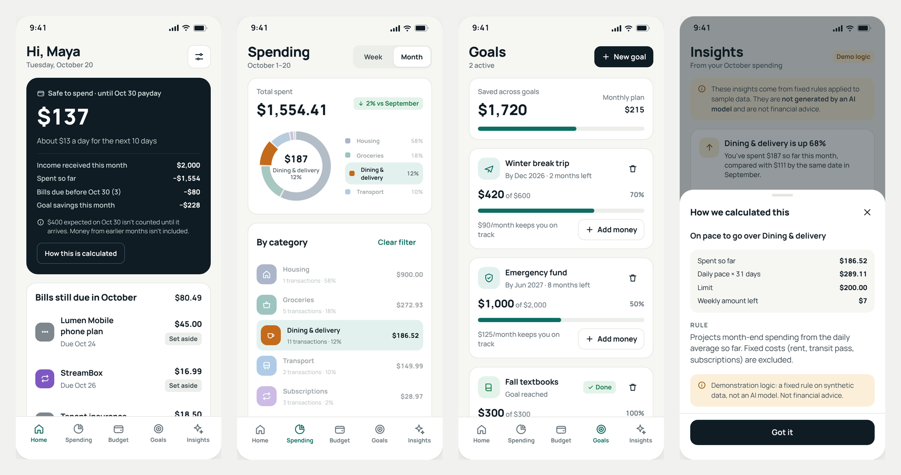
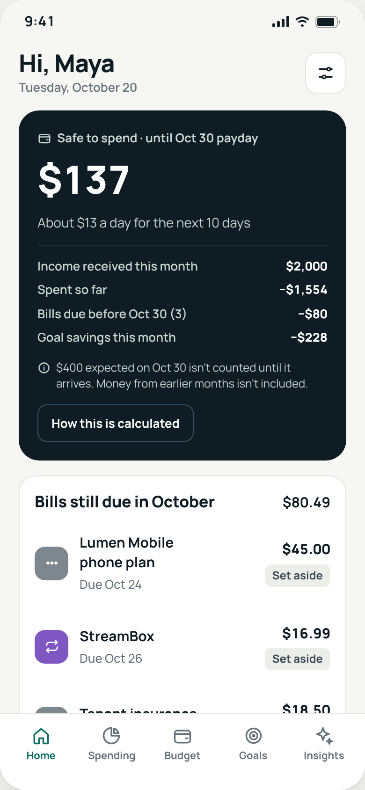
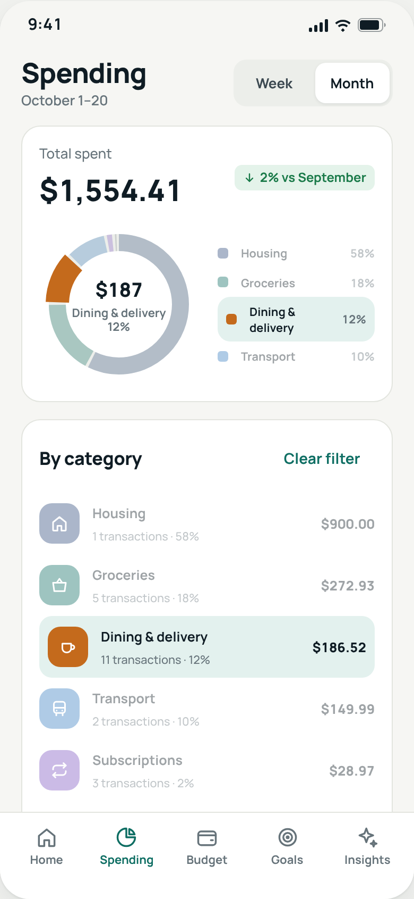
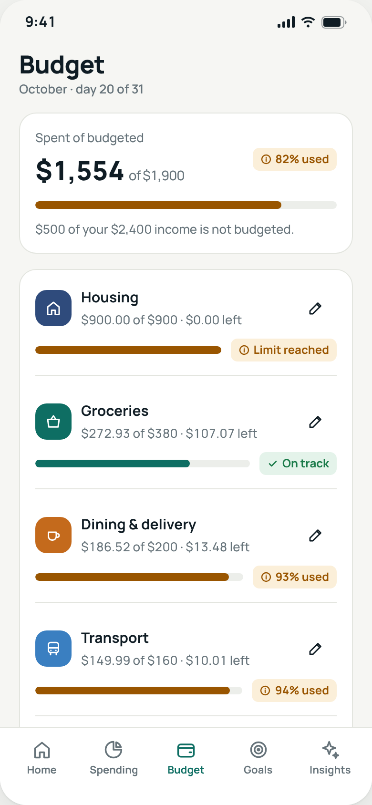
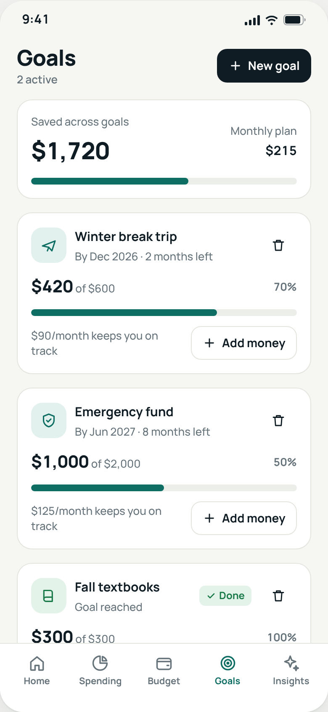
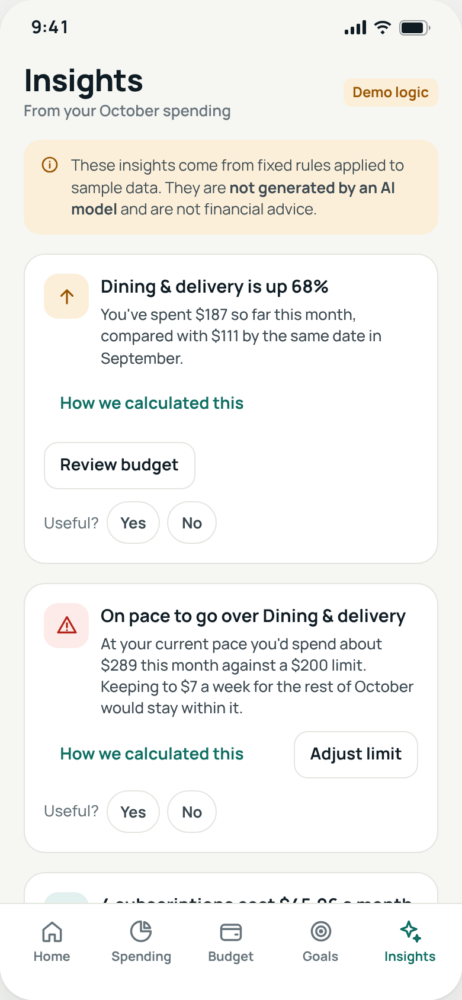
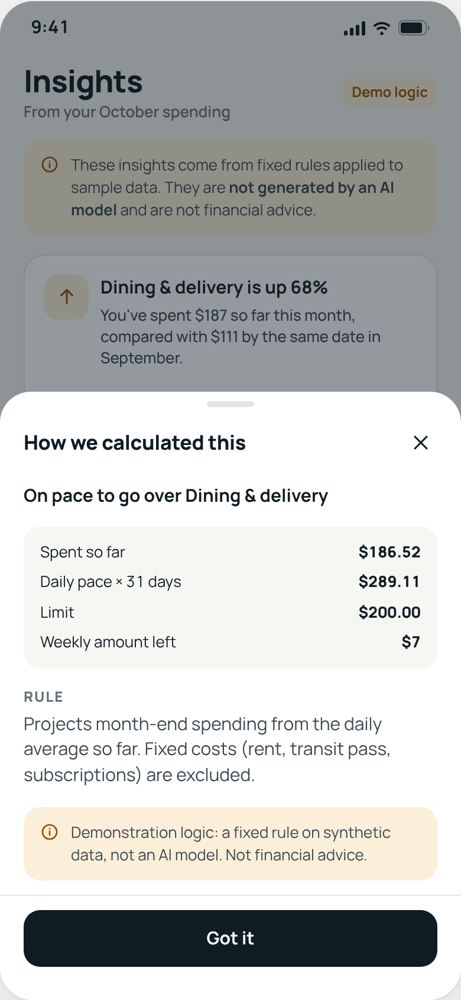
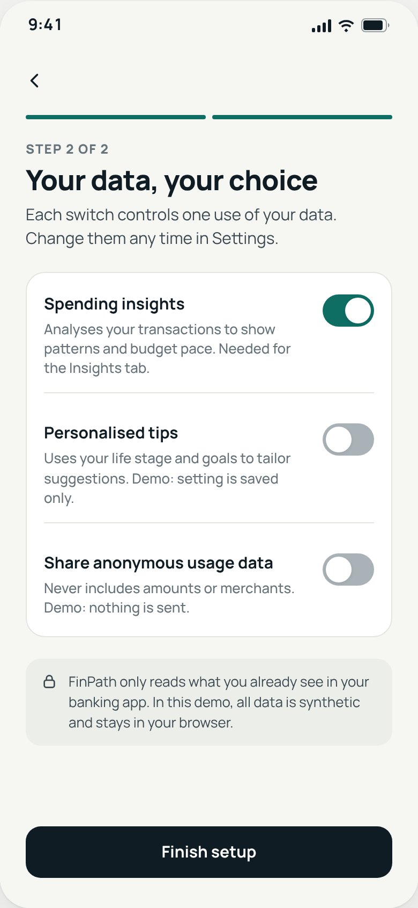
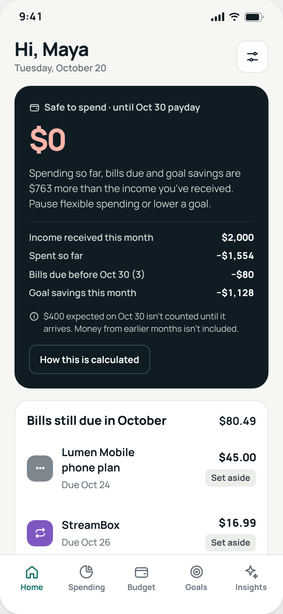

# FinPath: AI-Assisted Financial Planning (Product Concept)

**A business analysis and product design case study, with a working prototype.** FinPath helps Canadian university students and young professionals:
- see what they can safely spend before their next income;
- build a budget in minutes;
- make steady progress toward savings goals.

### ▶ [Live Demo](https://majestic-sundae-6965fc.netlify.app) · 📄 [Case Study (PDF, 12 pages)](docs/case-study/FinPath_Case_Study_Version_2.pdf) · ✅ [Verified QA Report](docs/qa-report.md)

> **Independent concept.** FinPath is a personal portfolio project by Cindy Wang. It is **not** an RBC product and is **not** affiliated with or endorsed by RBC or any financial institution.
>
> **Synthetic data only.** No login, no bank connection, and no real financial information.
>
> **"AI-assisted" means rule-based demo logic for now.** Insights use transparent fixed rules and are labelled that way in the app. No AI model is connected.



---

## At a glance

| | |
| --- | --- |
| **Role** | Independent project: business analysis, product strategy, UX/UI design, prototyping and QA |
| **Target users** | Canadian university students, new graduates and young professionals (assumption-based proto-personas) |
| **Positioning** | A planning layer that could extend RBC's existing NOMI features in the RBC Mobile app. A concept, not a competing app. |
| **Deliverables** | Problem and opportunity analysis · assumptions register · stakeholder map · BRD with 7 business rules · 16 functional and 8 non-functional requirements · 15 user stories with acceptance criteria · NOMI competitive comparison · journey and service blueprint · business case and pilot metrics · design system · 22-screen working prototype · automated QA suite |
| **Built with** | One self-contained HTML file (HTML, CSS, vanilla JavaScript). No frameworks, no backend, no external requests. |
| **QA** | 96 of 96 automated checks pass, locally and against the live demo ([report](docs/qa-report.md)) |

## How to read this repository

Every claim is labelled as one of four kinds.

| Label | Meaning |
| --- | --- |
| **Fact** | Taken from a cited public source |
| **Assumption** | Not yet validated with real users (IDs A-1 to A-10) |
| **Proposed** | A target for a future pilot, not a measured result |
| **Implemented** | Works in the prototype and is covered by the automated tests |

No interviews, surveys or usability tests have been run yet. Validating the riskiest assumptions is the next step (see the [Roadmap](#roadmap)).

---

## 1. Business problem

Banking apps show what was spent. Young Canadians still have to work out what they can safely spend before the next deposit, whether a budget is realistic, and how to make progress toward a goal.

| Fact | |
| --- | --- |
| **37%** | of Gen Z Canadians say they feel in control of their money |
| **64%** | of Gen Z report financial stress several times a week, the highest of any generation |
| **20%** | say they don't know where to start managing their money |

*Source: TD Bank Group / Edelman Data & Intelligence (Harris Poll Omni). Fielded July 28–29, 2025, among 3,037 Canadians, about 500 aged 18–28. [Release, Oct 14, 2025](https://www.newswire.ca/en/releases/archive/October2025/14/c5267.html).*

**Problem statement.** Students and young professionals lack a simple, trustworthy way to turn spending into a plan they can act on daily. Whether FinPath's approach reduces stress and raises confidence is the central hypothesis to test.

→ Full analysis: [docs/product-analysis.md](docs/product-analysis.md)

## 2. Product concept

> For Canadian students and young professionals, FinPath turns transactions into one conservative **safe-to-spend** figure, a **budget** they can adjust in minutes, and **goals** with a monthly amount. Every insight shows its numbers and rule.

### The core rule: a conservative safe-to-spend number (BR-1)

```text
Safe to spend = income already received this month
              − spending to date
              − bills still due before the next expected income
              − this month's goal savings
```

- **Expected income isn't counted until it arrives.** The app names it and excludes it.
- **The figure is rounded down**, shown with a daily amount, and itemised on a "How this is calculated" sheet.
- **When the result is negative,** the app shows $0 and the size of the shortfall.

Version 2 replaced a simpler rule (income − spending − goals). That rule counted money that hadn't arrived and ignored unpaid bills: it showed $405 for a sample user who actually had $0 to spare. [Why BR-1 changed](docs/business-requirements.md#why-br-1-changed-in-version-2)

## 3. Competitive analysis: RBC NOMI

RBC already offers NOMI in the RBC Mobile app. FinPath was analysed against it honestly. Where public sources don't describe a NOMI capability, this project says so; it doesn't claim a gap.

| Capability | RBC NOMI (documented) | FinPath prototype | Assessment |
| --- | --- | --- | --- |
| Spending insights | NOMI Insights: categorised cash flow, "what's coming up" | Category chart and filters; 5 rule-based insights that show their math | Overlap; FinPath's bet is explainability |
| Budgets | NOMI Budgets (2019): recommended, adjustable, alerts at 50/75/100% | Pre-filled, editable limits; in-app warnings; no notifications | Overlap; NOMI ahead on notifications |
| Upcoming payments | NOMI Forecast (2021): 7-day view of upcoming payments; 900,000+ users by 2023 | Bills due and income timing feed one safe-to-spend figure | Strong overlap; a real build should reuse Forecast |
| Automated saving | NOMI Find & Save: automatic micro-savings | Not offered | NOMI ahead |
| Named goals with a date | Not described in the sources reviewed | Implemented | Unverified, not a confirmed gap |
| Questions | Ask NOMI: live, on real data | Keyword matching on synthetic data | NOMI ahead |

**Differentiation bets (unvalidated):**
- **B1:** one conservative number that reserves bills, income timing and goals is easier to act on.
- **B2:** goal-first planning motivates saving.
- **B3:** showing the math builds trust.

→ Sources and detail: [docs/product-analysis.md § 8](docs/product-analysis.md#8-competitive-analysis-rbc-nomi)

## 4. Requirements and user stories

**Business rules and their status in the prototype**

| ID | Rule | Status |
| --- | --- | --- |
| BR-1 | Safe to spend counts only income received; reserves bills before payday and goal savings | Implemented, tested |
| BR-2 | Budget limits are whole dollars, $0–$10,000 | Implemented, tested |
| BR-3 | Budgeting above planned income warns, doesn't block | Implemented, tested |
| BR-4 | Goal monthly amount = (target − saved) ÷ months left, rounded up | Implemented, tested |
| BR-5 | Insights educate; they never recommend financial products | Content rule; not enforced in code |
| BR-6 | Optional data uses start off | Implemented (two switches are stored only) |
| BR-7 | Users can delete all data after confirmation | Implemented, tested |

**Example user story: US-3 (Must)**
> *As a student, I want to know what's safe to spend before my next income.*
>
> **Acceptance criteria:** Given income has been received and a deposit is still expected this month, the dashboard shows safe to spend until that payday (BR-1). The expected deposit is named and excluded. A per-day amount divides by the days until payday. A negative result shows $0 and the shortfall. **Status: implemented and tested.**

→ [Business Requirements Document](docs/business-requirements.md) (objectives, scope, 7 rules, 16 FRs, 8 NFRs with status) · [All 15 user stories with acceptance criteria](docs/user-stories.md)

## 5. Business case

Each customer problem is linked to a feature, a measurable pilot outcome and the potential business value.

| Customer problem | Feature (implemented) | Pilot measure (proposed) | Potential value (hypothesis) |
| --- | --- | --- | --- |
| Don't know what's safe to spend (37% feel in control: fact) | Conservative safe to spend, itemised | Weekly use; confidence +0.5 after 60 days | More digital engagement; possibly fewer overdraft events |
| Don't know where to start (20%: fact) | Suggested, editable budget limits | Setup completion 70%; first-session plan 40% | Earlier primary relationship with young clients |
| Saving feels abstract (A-4) | Goals with a monthly amount | Month-2 goal contribution rate (baseline in pilot) | Savings growth if goals later link to real accounts |
| Generic advice, unclear data use (A-1, A-2) | Explained insights; per-use data switches | Insight opt-in 75%; usefulness ≥ 3.8/5 | Trust; evidence on whether ML insights beat rules |

**North-star metric (proposed):** the share of active users who stay within budget and contribute to a goal in the same month.

No revenue or ROI figures are estimated; they need finance input and pilot data.

## 6. Interactive prototype

### ▶ [Open the Live Demo](https://majestic-sundae-6965fc.netlify.app)

Choose **Load sample user** to explore with data, or **Start as a new user** to go through onboarding. The page has four tabs:

| Tab | What it shows |
| --- | --- |
| **Prototype** | The working app in a phone frame, with demo controls and jump links |
| **All screens** | All 22 screens and states, rendered by the same code |
| **Design system** | Colours, type, spacing and every component state |
| **Figma handoff** | Screen inventory, component specs and connection map |

### What's real, what's demo logic, what's a concept

| Status | Features |
| --- | --- |
| ✅ **Implemented** | Onboarding with validation · safe to spend with breakdown, bills card and calculation sheet · spending chart, category filters, daily bars and search · editable budgets with 80% and over-budget states · goal creation, contributions, completion and deletion · settings, larger text, privacy switches · delete all data · demo reset · data saved in the browser |
| 🟡 **Demo logic** | Insights (5 fixed rules) and "Ask FinPath" (keyword matching) on synthetic data. Labelled in the app; no AI model is connected. |
| 🟡 **Simulated** | Insight loading delay and connection error (Settings → Demo) |
| ⚪ **Concept only** | Monthly reminders, personalised tips and analytics sharing (switches saved, no effect) · life-stage tailoring · bank account linking · notifications |

| Dashboard | Spending | Budget | Goals |
| --- | --- | --- | --- |
|  |  |  |  |

| Insights | Calculation detail | Privacy choices | Over plan |
| --- | --- | --- | --- |
|  |  |  |  |

All 22 screens: [docs/screenshots](docs/screenshots) · Design system and screen inventory: [docs/design-system.md](docs/design-system.md)

## 7. Technical implementation

- **One self-contained file.** `index.html` (about 320 KB) holds everything inline: markup, CSS, JavaScript, fonts and the diagram. It loads nothing from the internet, works when opened from disk, and deploys as a static site. The live demo serves this exact file (verified by SHA-256 hash).
- **No frameworks or backend.** Vanilla JavaScript renders each screen from in-memory state; there is no build step.
- **Synthetic data.** Two months of transactions come from a seeded random generator, so every visitor sees the same data. Recurring bills and income come from fixed schedules. The prototype's "today" is fixed at October 20, 2026, so the calculations are reproducible.
- **Saved demo data.** Changes are stored in the visitor's own browser (`localStorage`, key `finpath-demo-v2`). "Reset demo data" or "Load sample user" restores the sample.
- **Accessibility built in:**
  - labelled controls, with invalid fields marked and linked to their messages;
  - focus moves into sheets and dialogs, and Escape closes them;
  - background content is inert while a sheet is open;
  - status never relies on colour alone;
  - a larger-text setting, and reduced motion is respected.

## 8. Testing and QA

**96 of 96 automated checks pass.** The suite ran on a clean checkout of `index.html` with the network blocked, and again against the live demo. See the [verified QA report](docs/qa-report.md).

| Area | Checks | Examples |
| --- | --- | --- |
| Validation | 16 | Every form rejects bad input with a specific message and focuses the field |
| Calculations | 15 | Safe to spend recomputed independently from the raw data; goal and budget rules |
| Responsive | 10 | No horizontal scroll at 360 px and 1440 px in all views; 820 px |
| Accessibility | 8 | axe-core scan of 6 screens and 2 sheets: 0 violations; focus and keyboard behaviour |
| Other | 47 | Goals, spending, insights, privacy, persistence, error recovery, navigation, standalone loading, no console errors |

- **What the checks do:** 92 checks drive the app like a user (Playwright, headless Chromium); 4 call calculation functions directly.
- **Defects:** QA found and fixed 6, three of them accessibility issues.
- **Accessibility caveat:** automated accessibility rules cover only part of WCAG, so this is not a conformance claim.
- **Why the counts differ:** the Version 2 case study reports 93 checks; this standalone build adds 3 checks (embedded fonts, embedded diagram, zero external requests).

### Run the tests

```bash
npm ci                                   # axe-core
pip install -r tests/requirements.txt    # Playwright for Python
python -m playwright install chromium
python tests/qa_suite.py                 # or: python tests/qa_suite.py --url https://majestic-sundae-6965fc.netlify.app/
```

Details: [tests/README.md](tests/README.md). A GitHub Actions workflow ([`.github/workflows/tests.yml`](.github/workflows/tests.yml)) runs the same suite on every push to `main`. It has not yet run on GitHub.

## 9. Limitations

- **No user research yet.** Personas, journeys and needs are assumptions, and all pilot targets are proposed, not measured.
- **Synthetic data with a fixed date.** The app doesn't connect to any bank or read real transactions.
- **No AI model.** "AI-assisted" features are rule-based demo logic.
- **Concept-only features:** reminders, notifications, account linking, and the personalised-tips and analytics switches.
- **Accessibility gaps:** touch targets on chips, toggles and small buttons are below the 44 px goal. There has been no screen-reader or real-device testing.
- **Browser coverage:** tested in Chromium only. Opened from disk in Safari, saved data may not persist; on the live site it does.
- **Not production software:** no security review, no French version, and performance not measured.

## Roadmap

1. **Validate:**
   - check the current RBC Mobile and NOMI features against the comparison;
   - 8–10 problem interviews;
   - a moderated usability test, including "Can I afford this?";
   - accessibility and screen-reader reviews.
2. **Pilot if validated:** real categorised data and NOMI Forecast predictions; term-based budgets for irregular income; meet the 44 px touch-target goal.
3. **Later:** open banking accounts after phase one; test ML insights against the rule-based baseline.

## Repository structure

```text
finpath-financial-planning/
├── index.html                     # The complete prototype (single self-contained file; the live demo)
├── docs/
│   ├── case-study/
│   │   └── FinPath_Case_Study_Version_2.pdf
│   ├── product-analysis.md        # Problem, evidence, assumptions, users, stakeholders, NOMI comparison, journey, business case, metrics
│   ├── business-requirements.md   # BRD: objectives, scope, business rules, FRs and NFRs with status
│   ├── user-stories.md            # 15 user stories with acceptance criteria and status
│   ├── design-system.md           # Tokens, components, screen inventory, connection map, Figma notes
│   ├── qa-report.md               # Verified test results (local and live)
│   └── screenshots/               # 22 screens + overview image
├── tests/
│   ├── qa_suite.py                # Automated QA suite (Playwright + axe-core)
│   ├── requirements.txt
│   └── README.md                  # How to run the tests
├── .github/workflows/tests.yml    # CI: runs the QA suite on GitHub Actions
├── package.json / package-lock.json   # axe-core (test dependency)
├── .gitignore
└── LICENSE
```

## About

Created by **Cindy Wang**, Master of Information student at the University of Toronto. [LinkedIn](https://www.linkedin.com/in/cindy-wang-cindyw)

Code is released under the [MIT License](LICENSE). Embedded fonts (Manrope, IBM Plex Mono) are under the SIL Open Font License 1.1. RBC and NOMI are trademarks of Royal Bank of Canada; they are referenced here only for competitive analysis.
